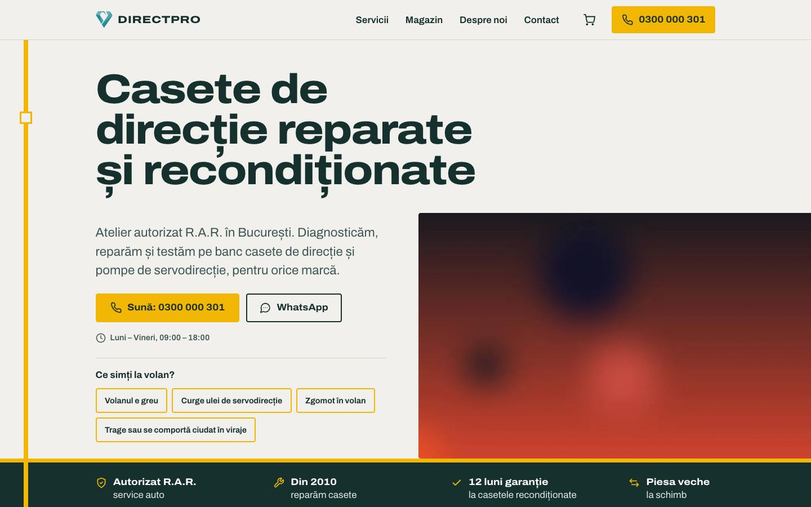
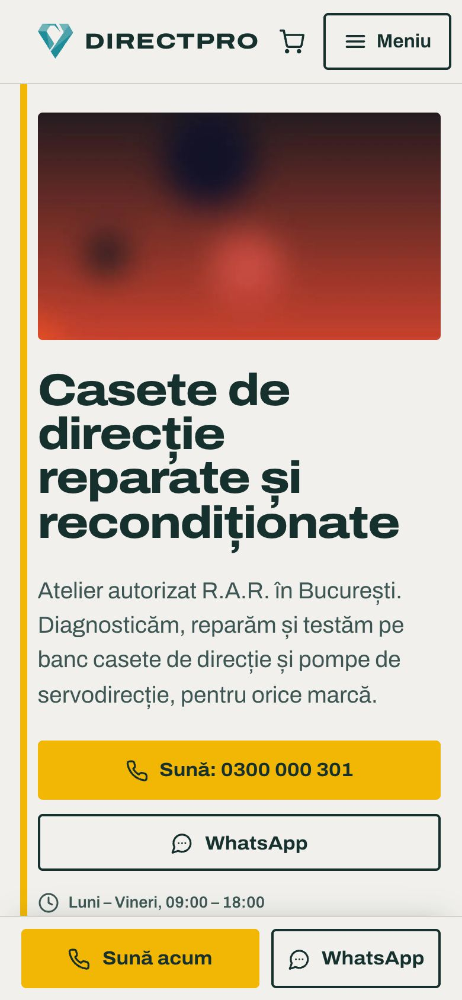
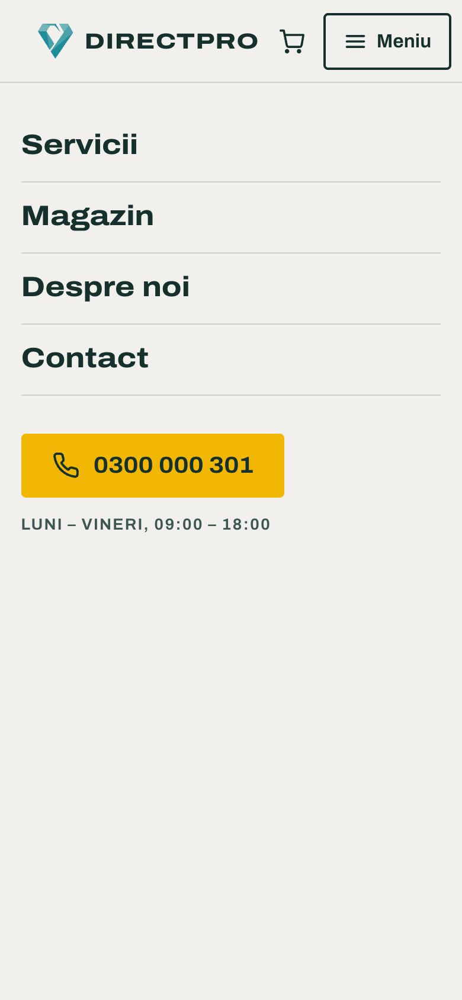
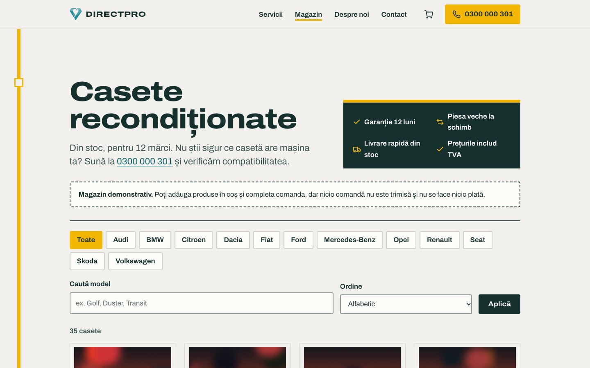
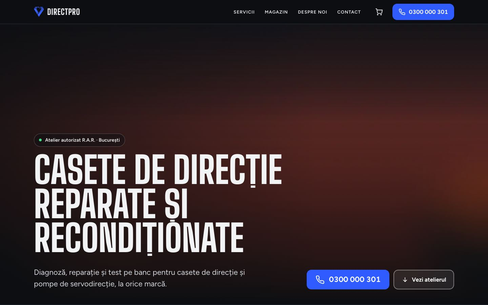
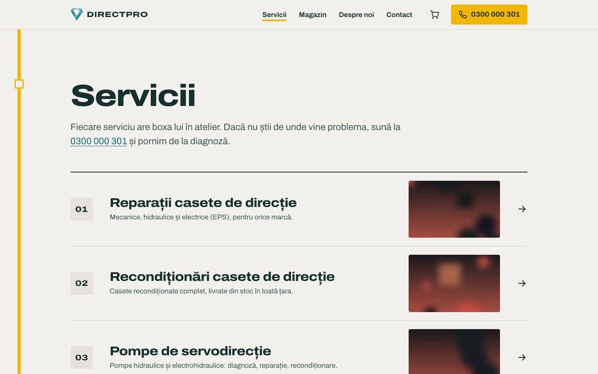

# DirectPro



Magazin online și site de prezentare pentru reparația casetelor de direcție, în patru variante (Astro).

> Proiect demonstrativ. Firma, adresa, telefoanele, emailurile și recenziile sunt fictive. Orice asemănare cu o firmă reală este întâmplătoare.

## Capturi de ecran

| Prima pagină, telefon | Meniul pe telefon | Magazin | Șablonul 3 | Servicii |
|---|---|---|---|---|
|  |  |  |  |  |

## Tehnologii

Astro (TypeScript) cu adaptor Node pentru randare pe server, fonturi Fontsource găzduite local.

## Decizii tehnice

- Repo-ul conține patru variante de design ale aceluiași site (`directpro-mvp` și trei șabloane), ca să poată fi comparate înainte de alegerea finală.
- Magazinul citește produsele dintr-un fișier JSON (`data/products.json`), ușor de editat fără bază de date.
- Panoul de administrare folosește o singură parolă din variabila `ADMIN_PASSWORD` și o sesiune semnată HMAC într-un cookie httpOnly, cu limită de încercări la autentificare.
- Coșul și comanda sunt demonstrative: produsele se păstrează în localStorage, iar la final nu se trimite nimic și nu se cere plata.
- Imaginile din pagini trec prin componentele de imagine ale Astro (`astro:assets`), care generează dimensiunile potrivite.
- Accesibilitate: link „Sari la conținut”, focus vizibil la navigarea cu tastatura.
- Animațiile se reduc sau se opresc pentru cine a setat „reducerea mișcării” în sistem (`prefers-reduced-motion`).
- Imaginile din afara ecranului se încarcă abia când e nevoie de ele (`loading="lazy"`).

## Rulare

Fiecare variantă e un proiect Astro separat (`directpro-mvp/`, `directpro/directpro-sablon-1..3/`):

```bash
cd directpro-mvp
npm install
npm run dev
```

## Cum a fost realizat

Proiectul a fost conceput și dezvoltat de Cristian Lucaci. În procesul de creație am folosit și instrumente de inteligență artificială, ca sprijin la scrierea codului, la texte și la verificări. Deciziile de design, alegerile tehnice și forma finală îmi aparțin.

## Licență

Codul este publicat sub licența [MIT](LICENSE), © 2026 Cristian Lucaci.

Resursele terțe incluse (fonturi, biblioteci, fotografii sau modele 3D cu licență liberă) își păstrează licențele proprii, menționate lângă fișiere sau în pagină. Imaginile fără sursă menționată sunt grafică generată pentru acest proiect.
